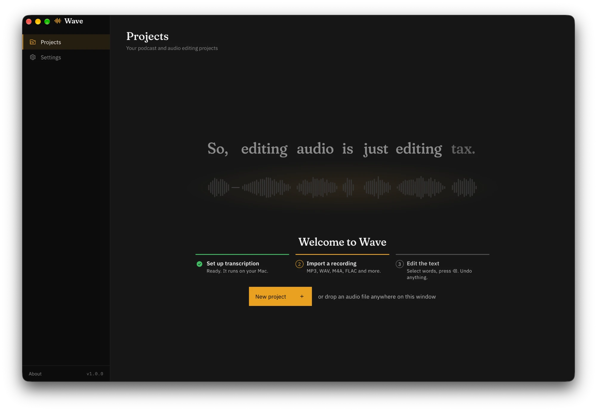

# Wave

**A text-based audio editor for podcasts, made for the Mac.** Edit audio by editing text: delete a word in the transcript and it's cut from the audio. Everything runs on your Mac. There's no cloud, no account and no upload.



## Download

**[Download Wave 1.0.0 for Mac (DMG, 17 MB)](https://github.com/mskayyali/wave/releases/download/v1.0.0/Wave_1.0.0_aarch64.dmg)** · [All releases](https://github.com/mskayyali/wave/releases) · [Website](https://mskayyali.github.io/wave/)

### What you need

- A Mac with Apple Silicon (M1 or later). Intel Macs aren't supported.
- macOS 13.4 (Ventura) or later.
- About 2 GB of free space for the speech models, and an internet connection to download them once. After that, Wave works offline.

Nothing else: no account, no FFmpeg, no Python.

### Install

1. Open the DMG and drag **Wave** into **Applications**.
2. Open Wave. It isn't notarized by Apple yet, so the first time, macOS says it can't verify that Wave is free of malware. Click **Done**, open **System Settings → Privacy & Security**, scroll down to the message about Wave and click **Open Anyway**, then confirm. You only do this once.

   Or, in Terminal:

   ```bash
   xattr -dr com.apple.quarantine /Applications/Wave.app
   ```

3. In Wave, click **Set up transcription** (or open **Settings**) and download **Transcription** (1.6 GB: Whisper Large v3 Turbo and the word aligner). Two more models are optional:
   - **DPDFNet** (14 MB): removes background noise and room echo.
   - **Speaker detection** (115 MB): finds who speaks when.

## Quick start

1. Click **New project** (⌘N) and choose a recording, or drop audio files anywhere on the window. MP3, WAV, M4A, FLAC and more work.
2. Wave transcribes it on your Mac. On an M3 Pro, that takes about an eighth of the recording's length.
3. Edit the text:
   - Select words and press ⌫ to cut them from the audio. Press **C** first to hear the result.
   - Press Space to play. The playing word is highlighted, and clicking a word jumps to it.
   - To fix a misheard word, select it and press ↩.
   - ⌘Z undoes anything. The original audio is never changed.
4. Use the **Tools** tab to shorten pauses, clean up the sound, apply an EQ preset or detect speakers.
5. Use the **Export** tab to save the edited audio as MP3, AAC, WAV or FLAC, and the transcript as TXT, SRT, WebVTT or JSON.

### Keyboard shortcuts

| Keys | What they do |
|---|---|
| Space | Play or pause |
| ← → | Back or forward 5 seconds |
| ⌫ | Delete the selection |
| C | Hear the selection as if it were cut |
| ↩ | Correct the selected word |
| ⌘Z, ⇧⌘Z | Undo, redo |
| ⌘F | Find in the transcript |
| [ ] | Select the previous or next word |
| Z | Zoom to the selection; again to go back |
| ? | Show every shortcut |

## Features

- **Local transcription:** Whisper writes what was said word for word, including "um" and "uh" in English, so you can cut them. A wav2vec2 aligner then places every word on its exact audio, so cutting a word removes all of it.
- **Text editing:** cut words, pauses or any stretch of audio. Cuts are joined with a short crossfade, and playback matches the export exactly.
- **An exact waveform:** trim what the text can't, like a breath or the tail of a word. A selection is exactly what you drag, and you can fine-tune its edges to the millisecond (⇧←/→).
- **Word corrections:** fix a misheard word. Corrections are marked in green, undo like any edit, and carry into every export.
- **Find:** ⌘F finds a phrase, marks every match and cuts them one by one.
- **Pauses:** shorten long pauses to a Tight, Natural or Relaxed rhythm, previewed first and undone in one step. You can also add a pause after any word, filled with the room's own quiet.
- **Speech enhancement:** remove background noise and room echo (DPDFNet), and set the loudness for podcast delivery (Apple Podcasts, Spotify and YouTube, or broadcast). You can preview 15 seconds against the original first, and switch between the two while playing.
- **EQ presets for the voice,** each named for what it fixes: Clearer, Warmer, Less boom, Less boxy, Less nasal, Brighter, Less harsh and Broadcast, at Subtle, Medium or Strong.
- **Speaker detection:** finds who speaks when, for up to 8 people. You can rename or merge speakers, select everything one person said, and export the names with the transcript.
- **AI agents:** let Claude or ChatGPT edit with you (see below). Their edits appear live and undo like your own.
- **Made for the Mac:** a full menu bar, drag and drop, and one status for everything running in the background, with progress on the Dock icon.

## Using Wave with Claude or ChatGPT

Wave includes an MCP server, so an AI agent can read your transcripts and make the same edits you can. For example, it can cut filler words and false starts, tighten pauses, fix misspelled names, enhance the audio and export.

1. In Wave, open **Settings → AI agents** and turn it on. The page shows the exact setup for your copy of Wave.
2. Add Wave to your agent app once. For Wave in Applications, the command is `/Applications/Wave.app/Contents/MacOS/wave` with the argument `mcp`.
   - **Claude Desktop:** Settings → Developer → Edit Config, then add the following and restart Claude:

     ```json
     {
       "mcpServers": {
         "wave": { "command": "/Applications/Wave.app/Contents/MacOS/wave", "args": ["mcp"] }
       }
     }
     ```

   - **Claude Code:**

     ```bash
     claude mcp add --scope user wave -- /Applications/Wave.app/Contents/MacOS/wave mcp
     ```

   - **Codex**, or the **ChatGPT desktop app** in its Codex and Work modes: Settings → MCP servers → Add server (STDIO, the command above, argument `mcp`), or run:

     ```bash
     codex mcp add wave -- /Applications/Wave.app/Contents/MacOS/wave mcp
     ```

3. Keep Wave open, and ask, for example: *"In my project Episode 12, remove the filler words and false starts, tighten the pauses, and enhance the audio with the Clearer EQ."*

Good to know:

- **Wave must be running** with AI agents turned on.
- **Your project opens in Wave** when an agent works on it, and you can watch the edits as they're made.
- **ChatGPT in the browser, and the desktop app's plain chat,** can't reach apps on your Mac, so they can't use Wave.
- **Agents can't hear the audio.** They work from the words, their timing and the pauses, so give the result a listen.

## Build from source

You need:

- A Mac with Apple Silicon and macOS 13.4 or later.
- Xcode Command Line Tools: `xcode-select --install`.
- [Rust](https://rustup.rs/).
- [bun](https://bun.sh/).
- [CMake](https://cmake.org/), which builds whisper.cpp: `brew install cmake`.

Then:

```bash
git clone https://github.com/mskayyali/wave.git
cd wave
bun install
bunx tauri dev      # run Wave in development
bunx tauri build    # build Wave.app and the DMG
```

`bunx tauri build` writes Wave.app and the DMG to `src-tauri/target/release/bundle/`. The first build takes several minutes: it compiles whisper.cpp with Metal support and downloads ONNX Runtime.

MP3 export uses LAME, which is prebuilt in `src-tauri/vendor/lame/`. To rebuild it, run `build.sh` in that folder.

### How it's put together

Wave is a [Tauri 2](https://tauri.app/) app. The interface is React and TypeScript with IBM's Carbon design system (`src/`), and the audio work is in Rust (`src-tauri/src/`):

| File | What it does |
|---|---|
| `projects.rs` | Projects, audio import, edits and audio export |
| `transcription.rs` | Transcription with whisper.cpp (`whisper-rs`, on the GPU) |
| `alignment.rs` | Word timings by wav2vec2 forced alignment (ONNX Runtime) |
| `enhance.rs`, `dpdfnet.rs`, `eq.rs`, `master.rs` | Noise removal, EQ, and loudness (ITU-R BS.1770-4) with a true-peak limiter |
| `encode.rs`, `lame.rs` | MP3, AAC, WAV and FLAC files |
| `speakers.rs` | Speaker detection |
| `waveform.rs` | The waveform the editor draws |
| `agent.rs`, `mcp.rs` | The MCP server for AI agents |
| `models.rs` | Model downloads |

Everything is stored in `~/Library/Application Support/com.mskayyali.wave/`: the models in `models/`, and each project in `projects/`. Edits are kept as a list and only applied to the audio at export, so the original is never changed.

## Credits

Wave runs these models, downloaded in the app:

- [Whisper](https://github.com/openai/whisper) Large v3 Turbo through [whisper.cpp](https://github.com/ggml-org/whisper.cpp) (MIT).
- [wav2vec2](https://huggingface.co/facebook/wav2vec2-base-960h) (Apache-2.0).
- [DPDFNet](https://github.com/ceva-ip/DPDFNet) by Ceva (Apache-2.0).
- [Nemotron 3 Diarization](https://huggingface.co/nvidia/Nemotron-3-Diarization) by NVIDIA (OpenMDW 1.1).

MP3 export uses [LAME](https://lame.sourceforge.io/) 3.100, bundled as a separate library under the LGPL. Its source is at [sourceforge.net/projects/lame](https://sourceforge.net/projects/lame/files/lame/3.100/).

Built by [Saleh Kayyali](https://mskayyali.com) ([@mskayyali](https://x.com/mskayyali)).
