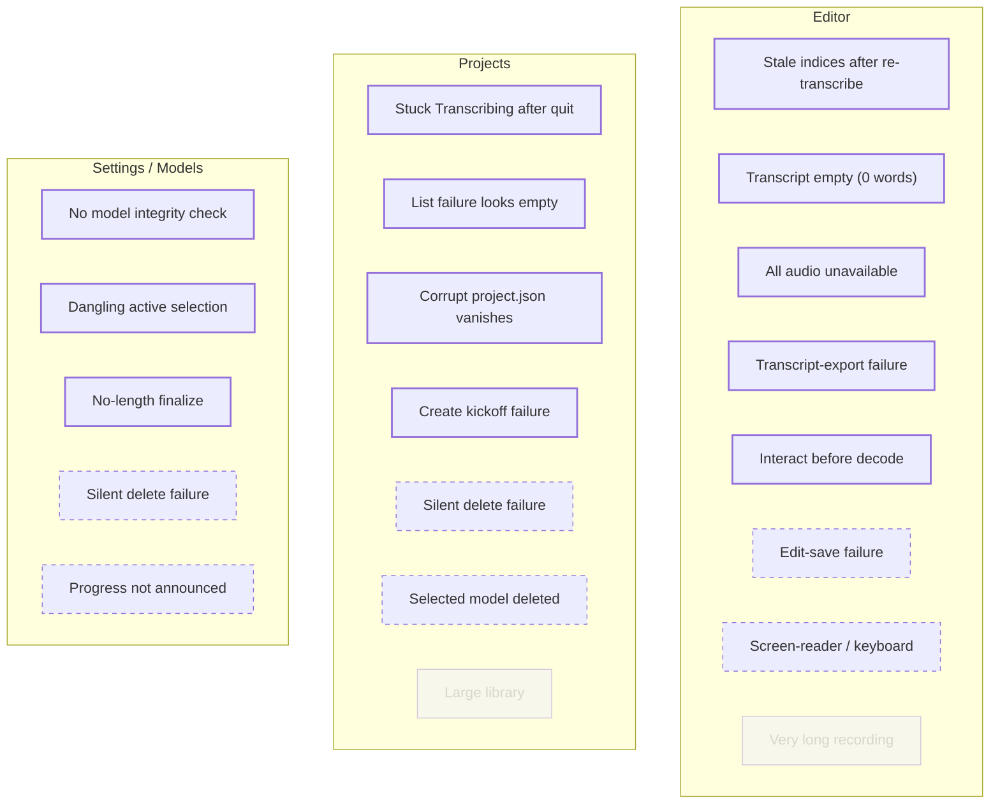

# Stateful working memory

Last updated: 2026-07-12 by state-audit

Product: **Wave** — local-first, Mac-native text-based audio editor. Audited as three surfaces (Editor, Projects, Settings/Models) plus a shared cross-cutting inventory, per the whole-product shape in PRACTICE.

## Surfaces in scope
- **Editor** — `src/pages/EditorPage.tsx` + `src/components/editor/*`, backed by `src-tauri/src/{projects,transcription}.rs`.
- **Projects** — `src/pages/ProjectsPage.tsx` + `src/hooks/useProjects.ts`, backed by `src-tauri/src/projects.rs`.
- **Settings/Models** — `src/pages/SettingsPage.tsx` + `src/hooks/useModels.ts`, backed by `src-tauri/src/models.rs`.

---

## Cross-cutting inventory (recurring conditions across surfaces)
Enumerated once; each surface's triage inherits rather than re-enumerating.

- **No model ready.** Gates Projects (banner + modal, `src/pages/ProjectsPage.tsx:342`); drives Settings. Handled.
- **Dangling active-model selection.** Deleting the selected model leaves `selectedModelId` set (auto-select only fires when empty, `src/App.tsx:37`) → next transcription fails "Model file not found" (`src-tauri/src/transcription.rs:69`). **Gap** (owner: Settings; bites Projects/Editor).
- **App quit mid-async-job.** Import → repaired on relaunch (`src-tauri/src/projects.rs:202`); Transcription → **not** repaired (stuck `Transcribing`); Download → resumable via `.part`. Inconsistent reconciliation.
- **Disk full / write failure.** Handled in download (ENOSPC → message, `src-tauri/src/models.rs:354`) and import (error status); **silent** in edit-save and transcript-export.
- **Corrupt on-disk artefact.** `project.json` → project silently dropped; `edits.json` → silently "start fresh"; `transcript.json` → error surface; model `.bin` → no integrity check. Inconsistent.
- **First run (no models, no projects).** Handled — empty states + banners.

Combined triage (22 gaps across surfaces): **In 12 · Out-with-implication 8 · Out 2.**

---

## Surface: Editor

### System sentence (confirmed)
Wave's editor is a persistent, non-destructive editing session that layers a revisable queue of time-range cuts over immutable transcribed audio, previewed live by skipping cuts and reconciled from disk on each re-entry, resolved into new audio only at export.

Raw material: **Time** async transcription + RAF playback clock, no TTLs · **Lifecycle** immutable transcript, revisable cut queue, preview/export files on demand · **Channels** local only; `asset://` audio, native save dialog · **Completion differences** edits persist to `edits.json`, audio decode may fall back, playhead not persisted · **Surfaces** Flow/Segments views, waveform+regions, word chips, ruler, Inspector (Export/Edits/Details), exports.

### Enumeration
Active 17 · Failure 14 · Boundary 10 · Rendering 17 = **58**.

### Gaps
| # | State | Category | Layers | Cause | Likely current behaviour (evidence) | Implication |
|---|---|---|---|---|---|---|
| ED-G1 | Stale edit indices after re-transcription | boundary/failure | fe, dm | system | Cut queue is positional indices into the transcript, persisted with no version link; on re-transcribe, in-range indices cut the **wrong** words, out-of-range drop at `src/pages/EditorPage.tsx:275`. | Fingerprint `edits.json` against `transcript.json`; invalidate/remap + notify. |
| ED-G2 | Transcript present but 0 words | rendering/active | fe | — | Blank TipTap doc over normal audio; `EditorBody` checks `!transcript` not empty (`src/pages/EditorPage.tsx:136`), `buildDocument` empty branch (`src/components/editor/TranscriptEditor.tsx:16`). | "No speech detected" state + re-transcribe/model path. |
| ED-G3 | All audio unavailable | failure | fe, be | system | Fallback chain ends at `console.warn` (`src/pages/EditorPage.tsx:342`); waveform never loads, no error shown. | Explicit "audio missing" state. |
| ED-G4 | Transcript-export failure | failure | fe | system | `console.error` only (`src/components/editor/InspectorPanel.tsx:72`); audio export has the surface (`:161`). | Mirror the audio-export inline error. |
| ED-G5 | `edits.json` save failure | boundary | fe, dm | system | Swallowed at `console.warn` (`src/pages/EditorPage.tsx:374`); cuts silently unpersisted. | "Changes not saved" indicator. |
| ED-G6 | All audio deleted (empty export) | failure | fe, be | user-input | Near-empty WAV, no floor/warning in `export_audio`/`write_spliced`. | Disable/confirm export when no survivor audio. |
| ED-G7 | Screen-reader / keyboard rendering | rendering | fe | — | Waveform/ruler/chips `aria-hidden`; editing pointer-only. | a11y layer atop word `data-*` attrs. |
| ED-G8 | External change to on-disk transcript/audio | boundary | fe, dm | external | No detection; trusts files at mount. | In-scope with any sync story. |
| ED-G9 | Very long recording in memory | boundary | be, inf | system | Whole file into RAM at splice (`~230 MB/60 min`). | Streaming splice for long-form. |
| ED-G10 | Interaction before audio decodes | boundary | fe | — | `waveLoading` tracked but clicks/keys live during decode. | Gate destructive actions on `ready`. |

**Top 3:** ED-G1 (data-integrity landmine), ED-G2 (blank editor on non-speech audio), ED-G3/G4/G5 (silent-failure house pattern). Full narratives in prior audit output.

### Triage (CONFIRMED by user 2026-07-12)
10 gaps — In **5**: ED-G1, ED-G2, ED-G3, ED-G4, ED-G10. Out-with-implication **4**: ED-G5, ED-G6, ED-G7, ED-G8. Out **1**: ED-G9.

**Fixed 2026-07-12:** ED-G1 — `edits.json` is now fingerprinted against the transcript (`{v:2, fingerprint, actions}` shape); on a fingerprint mismatch the stale cut queue is discarded and an in-editor notice is shown, instead of positional indices being silently misapplied (`src/pages/EditorPage.tsx`).

### Re-entry — `editing-session-with-cuts` (active, in)
Q1 time-passed: cut queue restored (`editsLoadedRef`, `src/pages/EditorPage.tsx:348`); playhead resets. Q2: **n/a** (local single-window). Q3 no-preceding-state: non-`ready` handled (`:136`), 0-words not (→ED-G2). Q4 data-changed: re-transcription → stale indices (**ED-G1**) — the load-bearing one. Q5 after-failure: corrupt `edits.json` silently discarded (`:357`) — back up + notify instead.

---

## Surface: Projects

### System sentence (confirmed 2026-07-12)
Wave's Projects surface is a durable library of import-and-transcribe jobs, each a folder of audio, transcript, and edits advancing through a status lifecycle from empty to ready or error, re-listed from disk on every launch and gated by whether a local model exists.

Raw material: **Time** async import/transcription with progress events, no TTLs · **Lifecycle** `Empty → Importing → ReadyToTranscribe → Transcribing → Ready | Error`; folder created/deleted whole · **Channels** local; native file picker; no network · **Completion differences** re-listed from disk each launch; interrupted `Importing` repaired (`:202`) · **Surfaces** card grid, status badges, import/transcribe progress bars, empty state, no-model banner/gate, new-project + delete modals.

### Enumeration
Active 10 · Failure 8 · Boundary 6 · Rendering 9 = **33**. Well-handled: full status-badge set, import & transcription progress + error surfacing (`src/hooks/useProjects.ts:154`), delete confirm, no-model gate, empty/loading states.

### Gaps
| # | State | Category | Layers | Cause | Likely current behaviour (evidence) | Implication |
|---|---|---|---|---|---|---|
| PR-G1 | App quit mid-transcription | boundary | be, dm | system | `list_projects` repairs stale `Importing` only (`src-tauri/src/projects.rs:202`); a project left `Transcribing` stays stuck with a spinner badge and **no retry path**. | Repair stale `Transcribing` on launch (→ ReadyToTranscribe) as with import. |
| PR-G2 | `list_projects` failure | failure | fe | system | Caught to `console.error`, `loading=false` (`src/hooks/useProjects.ts:44`) → renders the **"No projects yet" empty state** (`src/pages/ProjectsPage.tsx:379`), identical to a genuinely empty library. | A distinct "couldn't load your projects" error state with retry. |
| PR-G3 | Corrupt `project.json` | boundary | be, dm | system | `read_project` returns `None` on parse failure (`src-tauri/src/projects.rs:56`); `list_projects` silently `continue`s (`:199`) → the project **vanishes** from the library. | A "damaged project" surface instead of silent disappearance. |
| PR-G4 | Silent delete failure | failure | fe | system | `deleteProject` re-throws but `handleConfirmDelete`'s `finally` closes the modal with no error (`src/hooks/useProjects.ts:97`, `src/pages/ProjectsPage.tsx:328`) → project stays, modal closes as if done. | Surface delete errors; keep the row. |
| PR-G5 | Project-create kickoff failure | failure | fe | system | `createProject` has no try/catch (`src/hooks/useProjects.ts:51`); a throw propagates through `handleCreate` (no catch, `src/pages/ProjectsPage.tsx:205`) → modal may hang, no feedback. | Wrap create like import; show inline error. |
| PR-G6 | Selected model deleted before transcribe | failure | fe, be | user-input | Auto-transcribe uses `selectedModelId` (`src/App.tsx:62`); if that model was deleted, transcription errors. Inherits cross-cutting *dangling selection*. | See cross-cutting; re-gate before kicking off. |
| PR-G7 | Large library (no virtualization) | rendering | fe | — | All cards rendered (`src/pages/ProjectsPage.tsx:391`); fine at small N. | Virtualize for hundreds of projects. |

**Top 3:** PR-G1 (stuck `Transcribing` — no way out), PR-G2 (failed list masquerades as empty library — data looks lost), PR-G3 (corrupt project silently vanishes).

### Triage (CONFIRMED 2026-07-12)
In **4**: PR-G1, PR-G2, PR-G3, PR-G5. Out-with-implication **2**: PR-G4 (implication: delete must not report success it didn't achieve), PR-G6 (implication: re-validate model before auto-transcribe). Out **1**: PR-G7 (in when libraries grow large).

**Fixed 2026-07-12:** PR-G1 — `list_projects` now repairs a stale `Transcribing` status on relaunch (transcript present → `Ready`, else → `Error`), mirroring the import repair (`src-tauri/src/projects.rs`).

### Re-entry — `transcribing` (active, in)
Q1 time-passed: **this is PR-G1** — return after quit finds a permanently-`Transcribing` card. Q4 data-changed: model deleted mid-run → failure with no in-flight recovery. Q5 after-failure: partial `transcript.json` from a crashed run isn't validated on next open (ties ED-G1). Q2/Q3 n/a (local, entered from library).

---

## Surface: Settings/Models

### System sentence (confirmed 2026-07-12)
Wave's Models settings is a fixed catalogue of six on-device Whisper models, each held in one of four disk-derived states, fetched over a resumable and cancellable network download, with a single active-model selection persisted across launches.

Raw material: **Time** long downloads, 4 Hz progress, 20 s connect timeout, ETA · **Lifecycle** `NotDownloaded → Downloading(.part) → Ready(.bin) | Partial(.part)`; delete removes both · **Channels** network (HuggingFace) · **Completion differences** status re-derived from disk each list; cancel/quit keep `.part` for resume; selection persists · **Surfaces** model grid cards with per-state controls, progress meter, active badge, error banner.

### Enumeration
Active 8 · Failure 9 · Boundary 6 · Rendering 5 = **28**. **Strongly handled** — the most robust surface: resume via `Range` (`src-tauri/src/models.rs:302`), cancel keeps `.part`, ENOSPC/404/429/503/connection-loss all mapped to messages (`:310`,`:354`), size-mismatch check (`:405`), disk-derived status (self-healing on external change), "Connecting…" pre-progress state.

### Gaps
| # | State | Category | Layers | Cause | Likely current behaviour (evidence) | Implication |
|---|---|---|---|---|---|---|
| SE-G1 | No model-file integrity check | failure | be | external | Only byte size is verified (`src-tauri/src/models.rs:405`); a corrupt-but-complete file is marked `Ready` and fails later at load (`src-tauri/src/transcription.rs:297`), far from where the user could act. | Verify a checksum on finalize; surface a re-download prompt. |
| SE-G2 | Dangling active-model selection after delete | failure/boundary | fe, be, dm | user-input | Deleting the active model doesn't clear `selectedModelId` (`src/hooks/useModels.ts:95`; auto-select only when empty, `src/App.tsx:37`). Next transcribe fails. | Clear/re-point selection on delete of the active model. |
| SE-G3 | Silent model-delete failure | failure | fe | system | `console.error` only (`src/hooks/useModels.ts:99`). | Surface delete errors. |
| SE-G4 | Finalize with no Content-Length | failure/boundary | be | external | Size check is skipped when `content_length == 0` (`src-tauri/src/models.rs:400`) and `.part` is renamed regardless (`:413`) → a truncated file can finalize as `Ready`. | Fall back to checksum when length is unknown (ties SE-G1). |
| SE-G5 | Download progress not announced | rendering | fe | — | `ProgressBar hideLabel` (`src/pages/SettingsPage.tsx:143`); no live-region for assistive tech. | Announce progress/completion. |

**Top 3:** SE-G1 (bad model surfaces only later, in the Editor), SE-G2 (delete the active model → transcription silently broken — cross-cutting), SE-G4 (no-length finalize can bless a truncated file).

### Triage (CONFIRMED 2026-07-12)
In **3**: SE-G1, SE-G2, SE-G4. Out-with-implication **2**: SE-G3 (implication: delete UI must not imply success), SE-G5 (implication: card structure already supports a live-region hook). Out **0**.

**Fixed 2026-07-12:** SE-G2 — deleting the active model now clears `selectedModelId`, so the auto-select effect re-points to another ready model instead of leaving a dangling selection that fails transcription (`src/App.tsx`).

### Re-entry — `downloading` (active, in) — *exemplary; included as a positive contrast*
Q1 time-passed: quit mid-download → `.part` on disk → relaunch shows `Partial` + Resume (disk-derived, `src-tauri/src/models.rs:285`). Q4 data-changed: `.bin` deleted externally → `list_models` re-derives `NotDownloaded`. Q5 after-failure: connection loss keeps `.part`, Retry resumes. Q2/Q3 n/a. This surface answers the re-entry questions correctly — the benchmark for the Editor/Projects gaps above.

---

## Decisions
- Surfaces audited: **Editor, Projects, Settings/Models** (whole product) + cross-cutting inventory.
- Triage: **all three surfaces confirmed** by user 2026-07-12.
- System sentences: **all three confirmed** by user 2026-07-12.
- `state-map.json`: **yes** — consolidated cross-surface mirror produced (`state-map.json`).
- **Fixed 2026-07-12:** ED-G1 (fingerprint edits vs transcript), PR-G1 (repair stale `Transcribing`), SE-G2 (clear dangling model selection). Verified: `tsc --noEmit` clean, `cargo check` clean.
- Remaining in-scope gaps not yet fixed: ED-G2, ED-G3, ED-G4, ED-G10, PR-G2, PR-G3, PR-G5, SE-G1, SE-G4.

## Graph

Legend: solid = in, dashed = out-with-implication, dimmed = out. Cut: **audit gaps only** (22 nodes) across three surfaces; handled states omitted for readability. No transitions drawn; the map records none.
